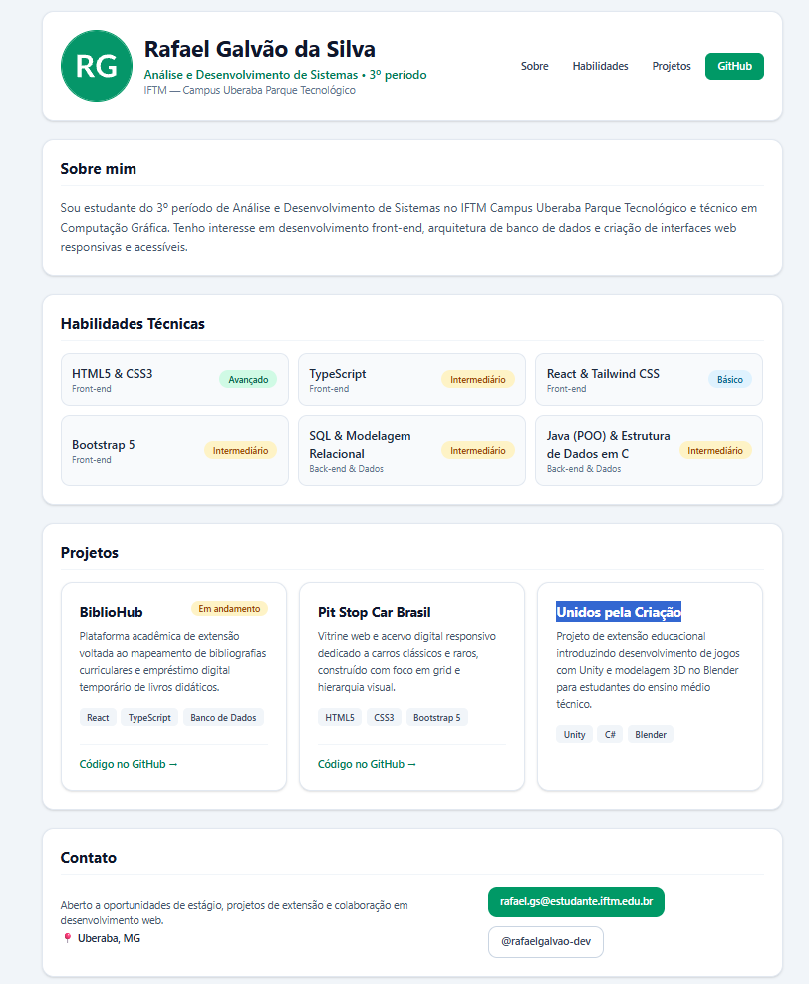

# Meu Portfólio em React — Atividade 1 (TIAW)

Página de apresentação pessoal desenvolvida para a disciplina de **Tecnologias para Interfaces de Aplicações Web** (IFTM — Campus Uberaba Parque Tecnológico)[cite: 1, 31].

## Preview da Aplicação



## Como rodar o projeto

```bash
# Instalar as dependências
npm install

# Iniciar o servidor de desenvolvimento
npm run dev